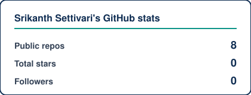
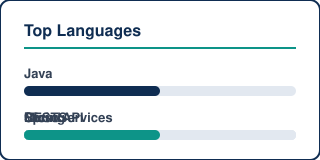

<!--
  Source: SrikanthSettivari_Resume.docx (personal)
  Palette: Navy #0F2D52 · Teal #0D9488 · Gold #E8B923 · Ink #334155
-->

  

   

  
  &nbsp;
  
  &nbsp;
  

---

### About me

**Lead Software Developer** with **15 years** of experience designing and shipping enterprise Java platforms — Spring Boot microservices, REST APIs, event-driven systems (Kafka/JMS), and cloud deployments on **AWS** and **OpenShift**.

Currently at **Cigna Healthcare** (Atlanta, GA), building healthcare microservices, Angular/React UIs, and cloud-native delivery. Previously **Athenahealth** and **GE Healthcare**, with hands-on **HL7 / FHIR** interoperability work.

| | |
|:--|:--|
| **Role** | Lead Software Developer |
| **Experience** | 15 years |
| **Location** | Atlanta, GA |
| **Focus** | Java · Spring Boot · microservices · AWS · healthcare APIs |
| **Learning** | Cloud-native scale · event streaming · production observability |
| **Open to** | Senior / Lead Java roles · collaboration on distributed systems |
| **Education** | MSIT (E-commerce), IIIT Hyderabad · PGDIT, JNTU Hyderabad |

---

### Tech stack

**Languages**

**Backend**

**Frontend**

**Messaging & data**

**Cloud, CI/CD & tools**

---

### Featured projects

Public GitHub samples (product / employer code stays private):

| Project | Description | Tech |
|:--------|:------------|:-----|
| [**java-concepts**](https://github.com/srikanthsettivari/java-concepts) | Concise Java reference notes | Java |
| [**interview-samples**](https://github.com/srikanthsettivari/interview-samples) | Interview-oriented Java samples | Java |
| [**movieproject**](https://github.com/srikanthsettivari/movieproject) | HTML/JS movie browsing demo | HTML · JS |
| [**testhtml**](https://github.com/srikanthsettivari/testhtml) | HTML/CSS layout experiments | HTML · CSS |

**Enterprise work (resume):** Cigna · Athenahealth · GE Healthcare — Spring Boot microservices, AWS/OpenShift, Kafka, Angular/React, HL7/FHIR.

---

### GitHub stats

<!-- Static SVGs in this repo — github-readme-stats.vercel.app is often 503/rate-limited -->

  
  &nbsp;
  

    

  

    

  
  &nbsp;
  

---

### Contact

  
  &nbsp;
  
  &nbsp;
  

---

  <em>Building reliable systems — from healthcare platforms to cloud-native APIs.</em>

